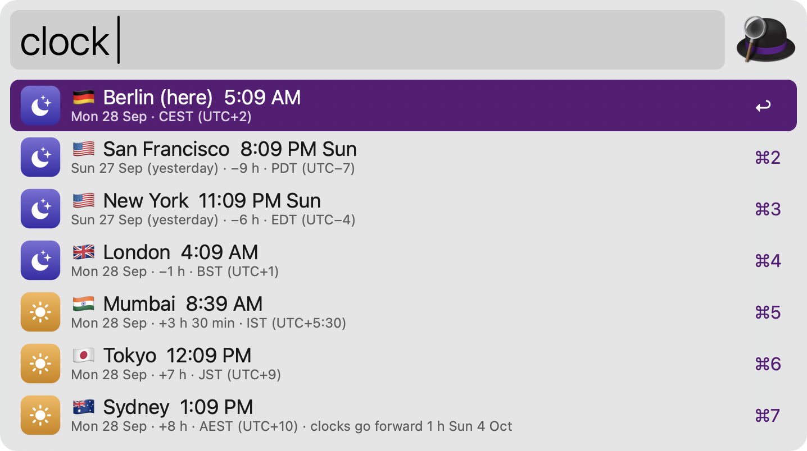
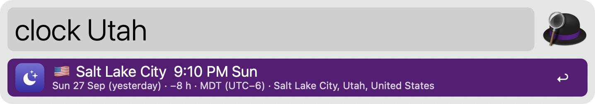
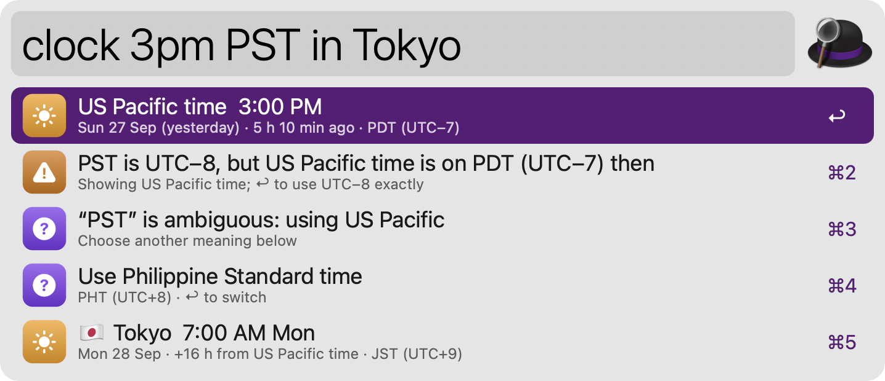
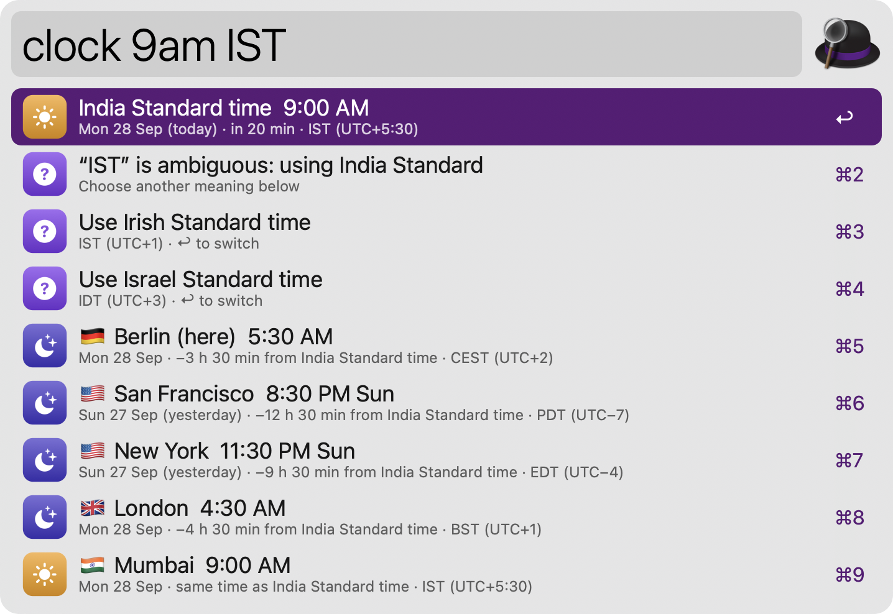
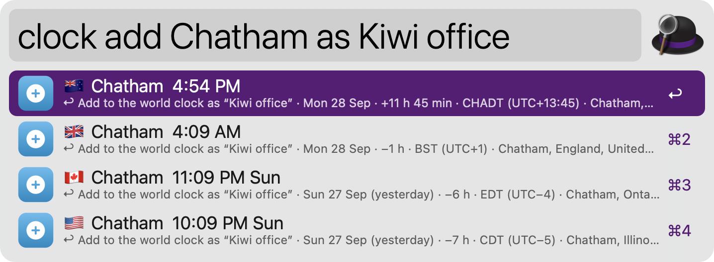
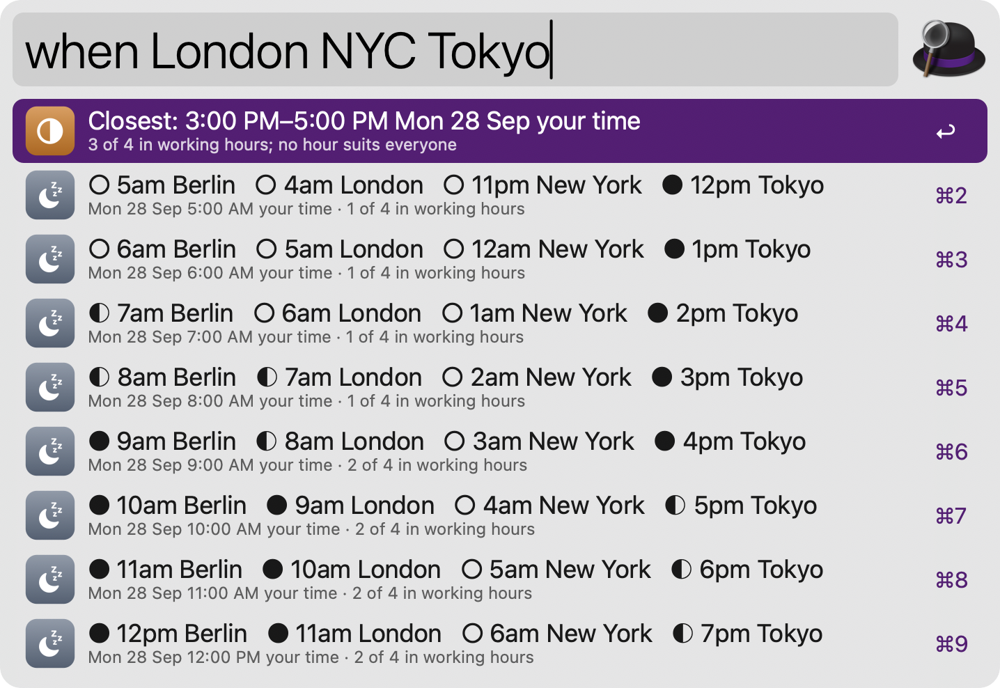
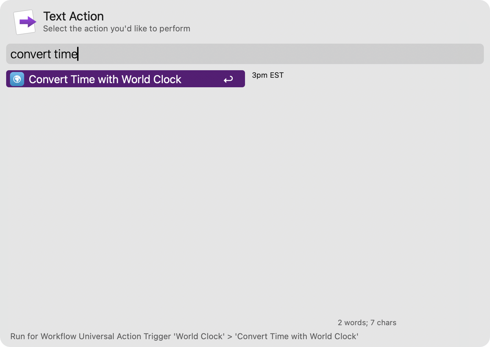

#  World Clock

See the time in your cities, convert times between time zones in plain English, and find a meeting time that suits everyone. No dependencies and no network: time zones come from macOS, so daylight saving time is always right.

## Usage

See the local time in your cities via the `clock` keyword. Each city shows its day, how far it is ahead of or behind you, its time zone and whether the sun is up there. The clock updates while Alfred is open.



* <kbd>↩</kbd> Copy the city’s time, like `10:05 PM JST, Tue 29 Sep`.
* <kbd>⌘</kbd><kbd>↩</kbd> Paste the time into the frontmost app.
* <kbd>⌥</kbd><kbd>↩</kbd> Copy the times of all cities.
* <kbd>⌃</kbd><kbd>↩</kbd> Copy the time as an ISO 8601 timestamp.
* <kbd>⇧</kbd><kbd>↩</kbd> Add the city to the world clock, or remove it.
* <kbd>⌘</kbd><kbd>L</kbd> Show the time in Large Type.

Type a city, country, state, time zone abbreviation (`CET`), time zone name (`America/Chicago`) or UTC offset (`UTC+5:30`) after the keyword to see its time. Over 34,000 cities are included.



### Converting times

Type a time with a place to convert it via the `clock` keyword, like `3pm PST in Tokyo`, `tomorrow 9:00 London to NYC`, `noon here in Berlin`, `now in Sydney`, `5pm PT Shanghai Zurich` or just `14:30 CET` to see it in all your cities. Times can be written as `3pm`, `15:30`, `1530`, `noon` or `midnight`, dates as `tomorrow`, `Friday`, `5 Oct`, `Oct 5` or `2026-10-05`, and `in 2 hours` works too.



When an abbreviation has several meanings, like `CST`, `IST` or `BST`, the most likely one for your region is used and the others are offered below: press <kbd>↩</kbd> on one to switch. When a typed time falls in a daylight saving change (it is skipped or happens twice), or an abbreviation like `EST` doesn’t match the season, a note explains what is shown.



### Adding cities

Manage your cities via the `clock` keyword followed by `add`. Type a name and press <kbd>↩</kbd> to add it, or add ` as Name` to give it a label, like `clock add Chatham as Kiwi office`. Press <kbd>↩</kbd> on a city already in your world clock to remove it.



### Meeting planner

Find a time that suits several cities via the `when` keyword, like `when London NYC Tokyo`. Each row is an hour in your time zone, with ● for working hours, ◐ for awake but outside working hours or at the weekend, and ○ for night. The best hours are starred at the top. Add a day to plan it, like `when London NYC Tokyo tomorrow`. Without cities, it uses your world clock.



* <kbd>↩</kbd> Copy that hour in every city.
* <kbd>⌘</kbd><kbd>↩</kbd> Paste it into the frontmost app.
* <kbd>⌥</kbd><kbd>↩</kbd> Copy the whole grid (from the first row when you plan for many cities).
* <kbd>⌃</kbd><kbd>↩</kbd> Copy the hour as an ISO 8601 timestamp.

Alternatively, convert a selected time like “3pm EST” via the Universal Action.



Keywords, the time and date format, the order of cities, working hours and flags can be changed in the Workflow’s Configuration.

City data comes from [GeoNames](https://www.geonames.org), licensed under [CC BY 4.0](https://creativecommons.org/licenses/by/4.0/).

## Development

```bash
python3 tools/make_cities.py                         # regenerate src/data from GeoNames
swift tools/make_icons.swift tools/icons.json src   # regenerate icons
python3 tools/build.py --package                     # write src/info.plist and dist/*.alfredworkflow
python3 tests/test_clock.py                          # run the tests
```

`src/data/cities.tsv` holds every place with 15,000 or more people from GeoNames’ `cities15000`, plus a place for each IANA time zone without one (from macOS’s `zone.tab`).

## AI disclosure

This workflow was developed with the help of Claude (Anthropic), an AI assistant. The code is reviewed and tested by the author.
